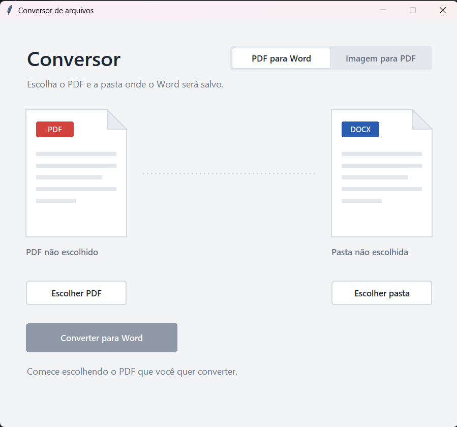

# Conversor de arquivos

Aplicativo para Windows com interface gráfica, feito em Python, que faz duas conversões:

- **PDF para Word** (`.pdf` para `.docx`)
- **Imagem para PDF** (uma ou várias imagens em um único PDF)

Você escolhe o arquivo, escolhe a pasta onde o resultado será salvo e clica em converter.



## O que ele faz

- Converte PDFs com texto selecionável em documentos do Word.
- Junta várias imagens em um PDF, uma por página A4, em ordem de nome.
- Aceita PNG, JPG, BMP, GIF, WebP e TIFF.
- Respeita a rotação das fotos de celular e coloca fundo branco em imagens com transparência.
- Avisa se o arquivo de destino já existe antes de substituir.

## Baixar o executável

Na página de [Releases](../../releases) está o `ConversorPDF.exe`. Não precisa instalar o Python.

## Rodar pelo código

Requisitos: Python 3.9 ou mais novo.

```bash
git clone https://github.com/SEU-USUARIO/NOME-DO-REPOSITORIO.git
cd NOME-DO-REPOSITORIO
pip install -r requirements.txt
python conversor_pdf_word.py
```

## Gerar o executável

```bash
pip install pyinstaller
pyinstaller --onefile --windowed --name ConversorPDF conversor_pdf_word.py
```

O arquivo fica em `dist/ConversorPDF.exe`.

## Limitações

- PDFs escaneados (só imagem) não são convertidos corretamente para Word. Para eles seria preciso OCR.
- PDFs com layout muito complexo (várias colunas, tabelas elaboradas) podem sair com pequenas diferenças no Word.

## Tecnologias

- [pdf2docx](https://github.com/ArtifexSoftware/pdf2docx) para a conversão de PDF em Word
- [Pillow](https://python-pillow.org/) para a conversão de imagens em PDF
- tkinter para a interface
- PyInstaller para gerar o executável